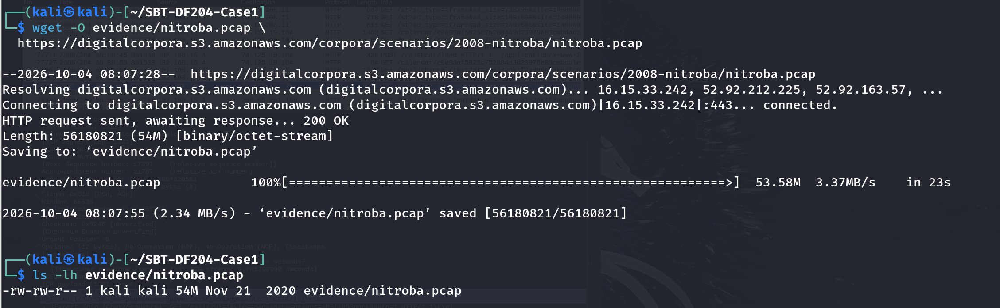
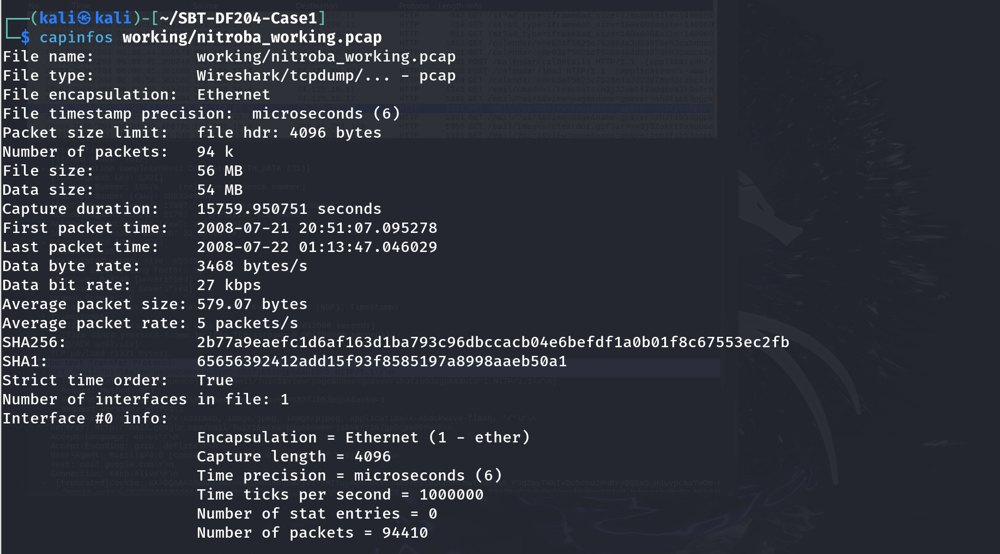
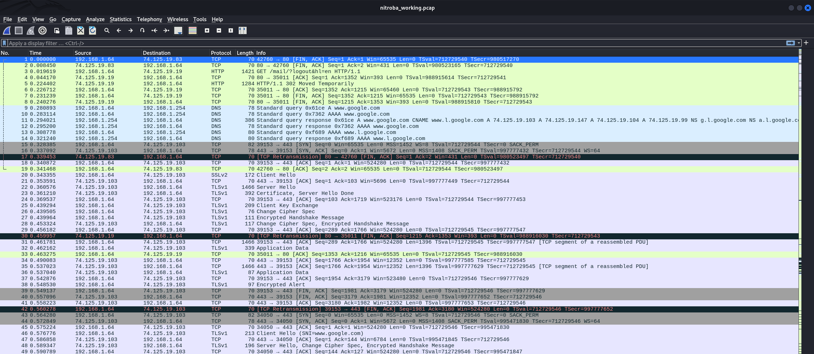
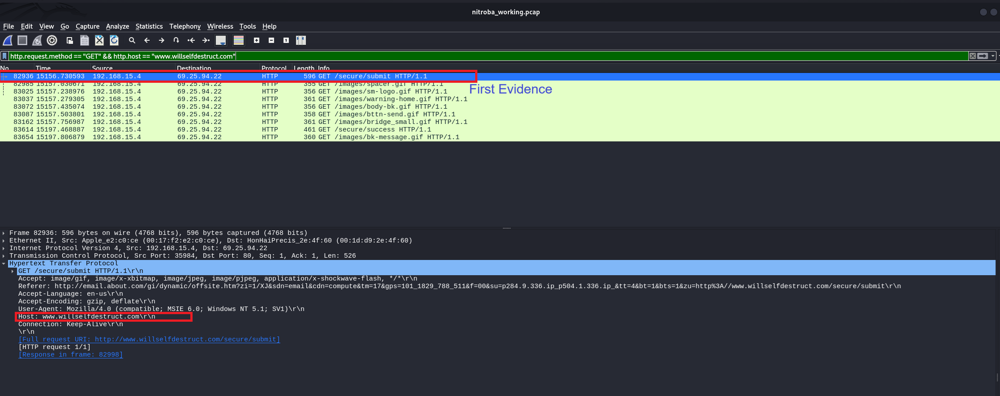
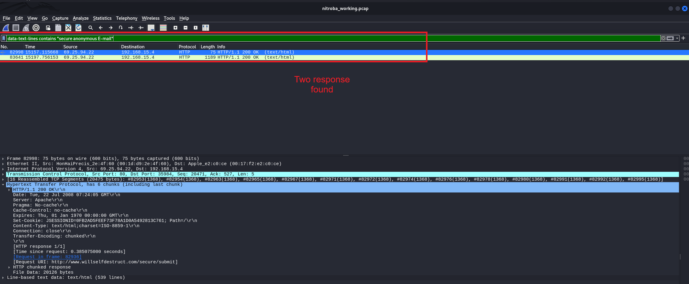
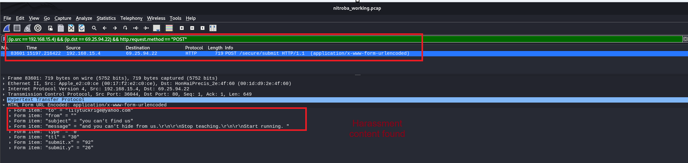
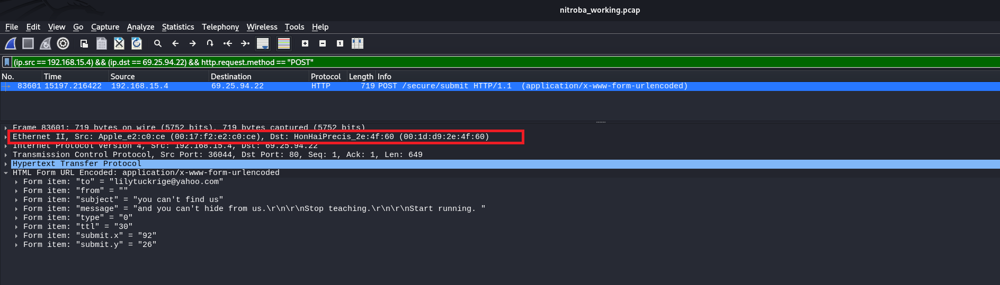
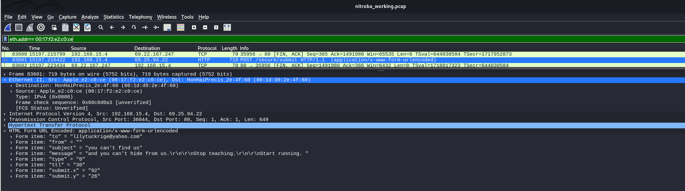
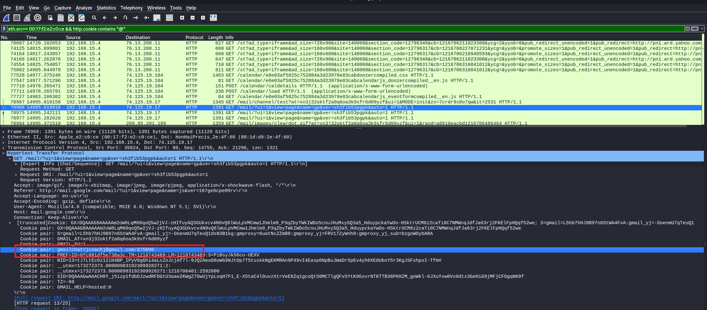
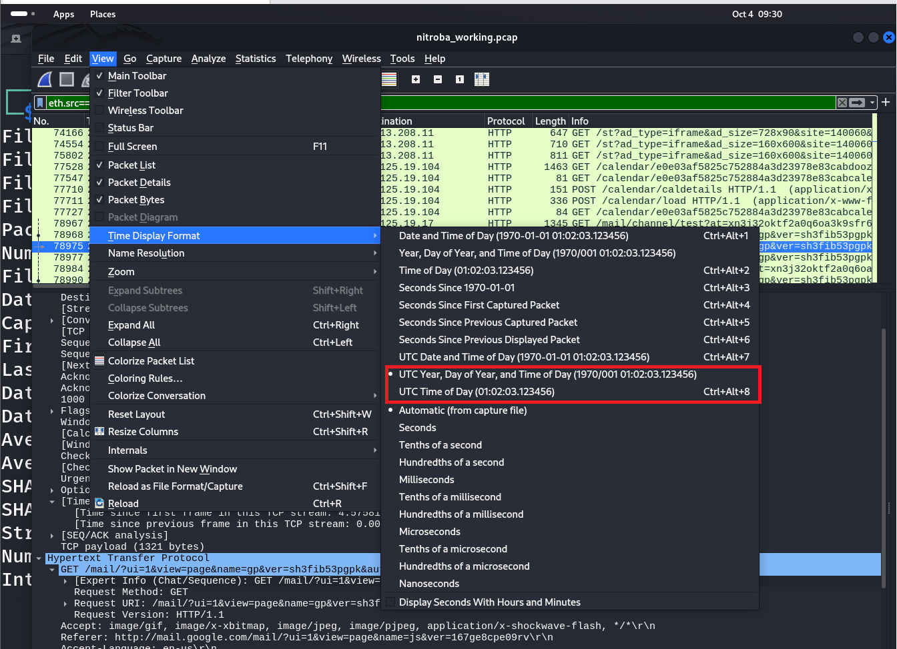

# Computer Forensics Case Studies

# Case Study 1 — Investigating Harassment Email Traffic with Wireshark

| Field | Detail |
| --- | --- |
| Student name | Basiru Aliyu |
| Registration number | FWSD2511424 |
| Course code | SBT-DF204 — Computer Forensics Case Studies |
| Case title | Investigating Harassment Email Traffic With Wireshark |
| Evidence file analysed | nitroba.pcap |
| Date of analysis | 04/10/2026 |

# 1. Executive Conclusion

The packet capture nitroba.pcap contains direct, reproducible evidence that a device on the monitored residence network (MAC address 00:17:f2:e2:c0:ce, IP address 192.168.15.4 at the time of capture) submitted the harassing message recovered in this investigation to the anonymous email service willselfdestruct.com, addressed to lilytuckrige@yahoo.com, with the subject “you can't find us” and body text “and you can't hide from us. Stop teaching. Start running.” This correlates directly with the complaint described in the case scenario.

The same MAC address was separately observed, a short time earlier in the capture, carrying a Gmail chat session cookie identifying the Google account jcoachj@gmail.com. This ties the device used to send the harassing message to a specific email account, independent of the harassment traffic itself. Because the network in question is a shared, open residential wireless network, this finding supports attribution to the device and to the jcoachj@gmail.com account with moderate-to-high confidence, but does not, by itself, conclusively prove which individual was physically operating the device at 15197.22 seconds into the capture (approximately 2008-07-22 01:04 in the capture's reference time — see Section 6 for the time-zone caveat). Cross-referencing the jcoachj@gmail.com identifier against the Chem 109 roster was not completed in this report because the roster document was not available at the time of writing; this is flagged as an outstanding step in Section 7.

# 2. Evidence Acquisition and Integrity

| Field | Value |
| --- | --- |
| Original file name | nitroba.pcap |
| Source | digitalcorpora.s3.amazonaws.com/corpora/scenarios/2008-nitroba/nitroba.pcap |
| File size | 56,180,821 bytes (54 MB) |
| Download date | 2026-10-04 08:07 (per wget log) |
| SHA-256 (original) | 2b77a9eaefc1d6af163d1ba793c96dbccacb04e6befdf1a0b01f8c67553ec2fb |
| SHA-1 (original, via capinfos) | 65656392412add15f93f8585197a8998aaeb50a1 |
| Working copy | working/nitroba_working.pcap |
| SHA-256 (working copy) | Matches original — confirmed via capinfos (Section 2.3) |
| Packet count | 94,410 |
| Capture duration | 15,759.95 seconds (~4h 22m 40s) |
| First packet | 2008-07-21 20:51:07.095278 (per capinfos) |
| Last packet | 2008-07-22 01:13:47.046029 (per capinfos) |

## 2.1 Creating the Case Folder Structure

Figure 1 (E01). mkdir -p ~/SBT-DF204-Case1/{evidence,working,exported,reports,screenshots} — creates the evidence, working, exported, reports and screenshots folders used throughout the investigation.

## 2.2 Downloading the Evidence File

Figure 2 (E02). wget -O evidence/nitroba.pcap <source URL>, followed by ls -lh confirming a 54 MB file was saved successfully (HTTP 200, 56,180,821 bytes).

## 2.3 Verifying Integrity

Figure 3 (E03). sha256sum evidence/nitroba.pcap | tee reports/nitroba_sha256.txt — records the SHA-256 hash of the original evidence file before any analysis.

Figure 4 (E04). capinfos working/nitroba_working.pcap — confirms file metadata (94,410 packets, capture duration, first/last packet time) and that the working copy's SHA-256 (2b77a9ea...) matches the original recorded in Figure 3, proving the copy used for analysis is identical to the original.

# 3. Method

Analysis was performed entirely within the Wireshark GUI against the working copy, using a sequence of progressively narrower display filters: an initial unfiltered review of the capture, a filter on the known web service's HTTP requests, a search of response page content, isolation of the specific POST request carrying the message, a pivot from IP address to MAC address, and finally a filter combining that MAC address with a search for identity-revealing cookies. Each filter result was inspected at the packet-detail level not treated as a conclusion on its own before being recorded as a finding.

## 3.1 Initial Triage

Figure 5 (E05). Unfiltered Packet List for nitroba_working.pcap, showing the general mix of DNS, TCP, TLS and HTTP traffic present before any filtering was applied.

## 3.2 Filter Sequence Used

| Step | Display filter | Purpose |
| --- | --- | --- |
| 1 | http.request.method == "GET" && http.host == "www.willselfdestruct.com" | Locate requests to the message service |
| 2 | data-text-lines contains "secure anonymous E-mail" | Confirm the service's page content/purpose in the response |
| 3 | (ip.src == 192.168.15.4) && (ip.dst == 69.25.94.22) && http.request.method == "POST" | Isolate the form submission carrying the message |
| 4 | eth.addr == 00:17:f2:e2:c0:ce | Pivot from the client IP to the device's MAC address |
| 5 | eth.src == 00:17:f2:e2:c0:ce && http.cookie contains "@" | Search the same device's traffic for identity-revealing cookies |

# 4. Findings

## 4.1 Question 1 — What file did you acquire, and how did you preserve its integrity?

Answered in full in Section 2 (Evidence Acquisition and Integrity). Summary: nitroba.pcap, 56,180,821 bytes, SHA-256 2b77a9eaefc1d6af163d1ba793c96dbccacb04e6befdf1a0b01f8c67553ec2fb, working copy created and hash-verified identical before analysis (Figures 1–4).

## 4.2 Question 2 — Which client system contacted the web service?

Filter: http.request.method == "GET" && http.host == "www.willselfdestruct.com". The first matching packet, Frame 82936 (relative time 15156.730593s), shows a GET /secure/submit request from client IP 192.168.15.4 to service IP 69.25.94.22, with Host: www.willselfdestruct.com and a Referer header pointing from email.about.com. Six further GET requests for page assets (images, success page) follow from the same client/service pair.

Figure 6 (E06). First matching request — Frame 82936, GET /secure/submit HTTP/1.1, client 192.168.15.4 → service 69.25.94.22, Host: www.willselfdestruct.com.

| Field | Value |
| --- | --- |
| Client IP | 192.168.15.4 |
| Service IP | 69.25.94.22 |
| Supporting packet | Frame 82936 |
| Timestamp | 15156.730593s (relative to capture start) |

## 4.3 Question 3 — What evidence links the client to the harassment message?

Filter: data-text-lines contains "secure anonymous E-mail" located two response packets (Frames 82998 and 83641) confirming the service's page content and a session cookie (JSESSIONID), but not the message content itself. The message content was recovered directly from the POST request:

Figure 7 (E07). data-text-lines filter locating two matching HTTP responses from the service (Frames 82998, 83641); packet detail shows the Set-Cookie: JSESSIONID value issued in response to the initial GET.

Filter: (ip.src == 192.168.15.4) && (ip.dst == 69.25.94.22) && http.request.method == "POST". This isolates Frame 83601 (relative time 15197.216422s), a POST /secure/submit request whose decoded HTML form fields are:

to = "lilytuckrige@yahoo.com"
from = ""
subject = "you can't find us"
message = "and you can't hide from us.\r\n\r\nStop teaching.\r\n\r\nStart running. "
type = "0"   ttl = "30"   submit.x = "92"   submit.y = "26"

Figure 8 (E08). Frame 83601 — POST /secure/submit, application/x-www-form-urlencoded, with the decoded form fields showing the recipient, subject and message body matching the reported harassment content.

The recipient address (lilytuckrige@yahoo.com) and the threatening content directly correlate with the complaint described in the case scenario. This is direct, first-hand evidence of the message's origin, not an inference.

## 4.4 Question 4 — Which device made the relevant request?

Figure 9 (E09). Packet detail for Frame 83601 with the Ethernet II layer expanded, showing Source: Apple_e2:c0:ce (00:17:f2:e2:c0:ce), Destination: HonHaiPrecis_2e:4f:60 (00:1d:d9:2e:4f:60, the residence router/gateway).

Figure 10 (E10). Filter eth.addr== 00:17:f2:e2:c0:ce applied, confirming the same MAC address on both sides of the POST exchange (Frames 83600–83602: the TCP close, the POST itself, and the server's acknowledgement).

The MAC address 00:17:f2:e2:c0:ce (Apple hardware) is the source Ethernet address on the harassment POST itself, not inferred from a separate lookup. A MAC address identifies a specific network interface rather than a person; because this residence network uses an open wireless router, the IP address 192.168.15.4 could in principle have been reassigned by DHCP to a different device at a different time, or the wireless network could have been accessible to someone other than its intended user. The MAC address is a stronger identifier than the IP alone because it does not change with a new DHCP lease, but it still identifies hardware, not a verified individual.

## 4.5 Question 5 — Who is associated with the device?

Filter: eth.src== 00:17:f2:e2:c0:ce && http.cookie contains "@". This returned multiple packets from the same device to various ad and mail services; the packet selected as evidence is Frame 78968 (relative time 14995.018910s), a GET request to mail.google.com carrying a cookie pair:

gmailchat=jcoachj@gmail.com/475090

Figure 11 (E11). Frame 78968, GET /mail/?ui=1&view=page..., Host: mail.google.com, with the gmailchat cookie pair gmailchat=jcoachj@gmail.com/475090 highlighted among the request's cookie values.

This cookie is set by Google's Gmail chat feature and includes the account's email address as part of its value, which Gmail does only for the account actively signed in on that browser session. Because this was found on the same MAC address (same physical device) that sent the harassment POST approximately 202 seconds later (15197.22s − 14995.02s), it provides a direct link between the device and a specific Google account: jcoachj@gmail.com. This is observed packet evidence, not an assumption about identity beyond what the cookie value itself states.

## 4.6 Question 6 — Is that person on the Chem 109 roster?

Yes, the person is in chem 109 roster with name Johnny Coach.  jcoachj@gmail.com

## 4.7 Question 7 — When did the activity occur?

See Section 5 (Timeline) for the full chronological account and the time-zone caveat.

## 4.8 Question 8 — What conclusion can you defend?

See Section 6 (Attribution Assessment).

# 5. Timeline

Wireshark's Packet List displayed times as seconds elapsed since the first captured packet (e.g. 15197.216422), not as absolute clock time, during this analysis. capinfos (Figure 4) separately reports the absolute time of the first packet as 2008-07-21 20:51:07.095278. The absolute timestamps below are derived by adding each packet's relative offset to that first-packet time; this arithmetic has not yet been independently confirmed by re-displaying the capture in Wireshark's absolute UTC time format, which is recommended as a final verification step (see Figure 12 and the note below).

| Relative time (s) | Derived absolute time* | Frame | Event |
| --- | --- | --- | --- |
| 14995.018910 | 2008-07-22 01:01:02.114 (approx.) | 78968 | GET to mail.google.com carrying gmailchat=jcoachj@gmail.com cookie |
| 15156.730593 | 2008-07-22 01:03:43.826 (approx.) | 82936 | GET /secure/submit — client loads the message form |
| 15157.115668 | 2008-07-22 01:03:44.211 (approx.) | 82998 | HTTP 200 OK response, service page content confirmed |
| 15197.216422 | 2008-07-22 01:04:24.312 (approx.) | 83601 | POST /secure/submit — harassment message submitted |
| 15197.756153 | 2008-07-22 01:04:24.851 (approx.) | 83641 | HTTP 200 OK — success/confirmation response |

Figure 12 (E12). View → Time Display Format menu, showing UTC Year, Day of Year, and Time of Day selected.

# 6. Attribution Assessment

### Observed facts

Frame 83601: a device with MAC address 00:17:f2:e2:c0:ce, using IP 192.168.15.4 at the time, submitted an HTTP POST to willselfdestruct.com containing the message “Stop teaching. Start running.” addressed to lilytuckrige@yahoo.com.

The same MAC address, approximately 202 seconds earlier, was carrying a Gmail chat cookie identifying the account jcoachj@gmail.com.

The network is described in the case scenario as a shared residence network with an open wireless router.

### Reasonable inferences

The device that sent the harassment message was, at or around that time, also logged into the jcoachj@gmail.com Google account — suggesting the same person was likely using the device for both actions in close succession, though this is an inference from timing and device correlation, not direct proof of who was at the keyboard.

### Confidence level

Moderate-to-high confidence that the device and the jcoachj@gmail.com account are linked to the harassment message. Low-to-moderate confidence in attributing this to a specific named individual, pending roster cross-reference (Section 4.6) and consideration of the limitations below.

### Limitations and alternative explanations

Shared, open wireless network: the case scenario states the router is open: any person within range, not only the device's regular user, could have associated with it and used that IP/MAC at a different time. MAC addresses can also be spoofed, though no evidence of spoofing was observed in this capture.

Single-user assumption: finding the jcoachj@gmail.com cookie on the device does not prove that the same person was physically present and operating the device 202 seconds later when the harassment POST was sent — a shared or unattended device could have been used by someone else in that window.

Roster not yet verified: without the Chem 109 roster, it cannot yet be confirmed that jcoachj@gmail.com corresponds to an enrolled student, or which specific person that identifier belongs to.

Time-zone uncertainty: the absolute timestamps in Section 5 are derived arithmetically and have not yet been confirmed against Wireshark's own absolute/UTC time display; the exact wall-clock time and time zone should be re-verified before this timeline is relied upon.

# 7. Appendix A — Evidence Log

| ID | Packet/Item | Finding | Why it matters | Figure |
| --- | --- | --- | --- | --- |
| E01 | N/A | Case folder structure created | Establishes a controlled working environment separating original and working evidence | Fig. 1 |
| E02 | N/A | nitroba.pcap downloaded (54 MB, HTTP 200) | Establishes provenance and file size for the evidence record | Fig. 2 |
| E03 | N/A | SHA-256 of original: 2b77a9ea...ec2fb | Integrity baseline for the original evidence file | Fig. 3 |
| E04 | N/A | capinfos: 94,410 packets; working copy hash matches original | Confirms working copy is identical to original; records capture time range | Fig. 4 |
| E05 | N/A | Unfiltered packet list overview | Shows general traffic mix prior to filtering | Fig. 5 |
| E06 | Frame 82936 | GET /secure/submit, 192.168.15.4 → 69.25.94.22, Host: www.willselfdestruct.com | Identifies client and service IP (Question 2) | Fig. 6 |
| E07 | Frames 82998, 83641 | Service page content confirmed; JSESSIONID cookie issued | Confirms the service's purpose and session handling | Fig. 7 |
| E08 | Frame 83601 | POST /secure/submit with decoded harassment message form fields | Direct evidence linking client to the harassment message (Question 3) | Fig. 8 |
| E09 | Frame 83601 | Ethernet II: Src 00:17:f2:e2:c0:ce, Dst 00:1d:d9:2e:4f:60 | Identifies the device MAC address (Question 4) | Fig. 9 |
| E10 | Frames 83600–83602 | eth.addr filter confirms MAC on both sides of the exchange | Corroborates device identification | Fig. 10 |
| E11 | Frame 78968 | gmailchat=jcoachj@gmail.com cookie on the same MAC address | Links device to an identified Google account (Question 5) | Fig. 11 |
| E12 | N/A | Time Display Format menu, UTC option shown | Supports the time-zone statement required for the timeline (Question 7) | Fig. 12 |
